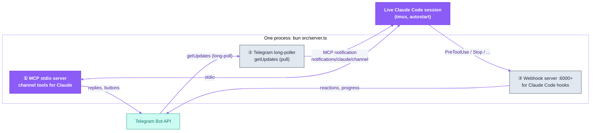
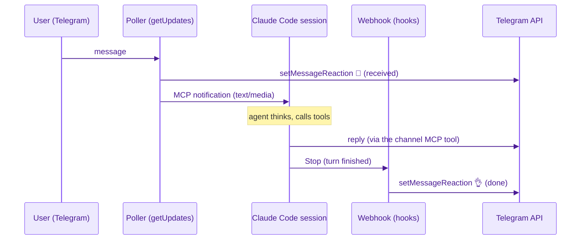

<p align="center">
  <picture>
    <source media="(prefers-color-scheme: dark)" srcset="assets/labops-logo-dark.svg">
    
  </picture>
</p>

<h1 align="center">labops-tg-plugin</h1>

<p align="center"><em>AI operations — from inside the profession</em></p>

<p align="center">
  <a href="https://labopsai.pro"></a>
  <a href="./LICENSE"></a>
  
</p>

<p align="center"><a href="README.md"><b>English</b></a> · <a href="README.ru.md">Русский</a></p>

<p align="center">
  <b>Part of labops:</b>
  <b>tg-plugin</b> ·
  <a href="https://github.com/dediukhinpa/labops-second-brain">second-brain</a> ·
  <a href="../agent-architecture">agent-architecture</a>
</p>

<p align="center">
  
</p>
<p align="center"><sub><i>Illustrative mockup of the two-stage reaction flow (👀 received → 👌 done) — not a screen recording.</i></sub></p>

---

## What it is

A Claude Code plugin (Bun runtime, TypeScript) that turns an ordinary `claude` session into a **long-lived Telegram agent**: your agent lives as a persistent session on a server and talks to you in Telegram — text, voice, media, status reactions, and interactive buttons. It registers as an **MCP server inside the live Claude Code session**, so Telegram is just an I/O channel — the same context, memory, and tools you already have, not a new headless process per message. Part of the **labops** architecture (see also [`labops-second-brain`](#part-of-labops) and [`agent-architecture`](#part-of-labops)).

---

## Quickstart

**Prerequisites:** none — `install.sh` auto-installs `bun ≥ 1.3`, `tmux`,
`claude ≥ v2.1.80` if any is missing.

**Bundled in the `labops-ai-assistant` monorepo.** This plugin is a bundled component (`tg-plugin/`) alongside [`agent-architecture`](../agent-architecture). The **single root `install.sh`** (at the monorepo root) installs it for you as part of the full setup — you don't run this component's own `install.sh` by hand (the root one invokes it, and it stays available under `tg-plugin/` if you ever need it directly). BotFather, the bot token, and each agent's own `channel.env` are handled per-agent, interactively, by `agent-architecture`'s `skills/create-agent/new-agent.sh`, which then provisions the bundled plugin into each new agent's workspace (`~/.claude-lab/<agent>/.claude/labops-tg-plugin`) automatically — as a **private copy**, not a symlink (only `node_modules` stays shared), so a monorepo edit does not reach a running agent until the plugin is re-provisioned. Just run, from the monorepo root:

```bash
bash install.sh
```

**Running this plugin standalone** (outside the monorepo, no shared memory)? It can still run on its own — but within this repo the root `install.sh` above is the way. To use it fully standalone, there's no `~/.claude-lab/<agent>/` layout to speak of — that's `agent-architecture`'s own convention. Clone it inside **your own workspace's `.claude` folder** instead — wherever you already keep (or plan to keep) this agent's `CLAUDE.md`: a project repo root, or simply your home directory for a single global agent. Claude Code discovers `CLAUDE.md` by walking up from the plugin's working directory, so the plugin has to live inside that same tree — see [`docs/02-where-to-place-plugin.md`](docs/02-where-to-place-plugin.md) for why. Configure it by hand:

1. Create a bot via [@BotFather](https://t.me/BotFather) → get the token; get your own user_id via [@userinfobot](https://t.me/userinfobot) — step by step in [`docs/telegram-setup.md`](docs/telegram-setup.md).
2. Fill in `channel.env` with the minimal vars:
   - `TELEGRAM_BOT_TOKEN` — token from BotFather
   - `TELEGRAM_EXPECTED_BOT_ID` — the numeric part before `:` in the token (anti-spoof)
   - `TELEGRAM_ALLOWED_USER_IDS` — CSV of allowed user_ids
   - `TELEGRAM_ALLOWED_CHAT_IDS` — CSV of allowed chat_ids
   - `TELEGRAM_WORKSPACE_ROOT` — the agent's workspace root
   - `TELEGRAM_STATE_DIR` — per-agent state dir
3. Run `./install.sh` (installs dependencies and hooks, then runs the tests).

```bash
# Clone INSIDE your workspace's .claude folder (location is critical — see
# docs/02). <your-workspace> is wherever this agent's CLAUDE.md lives — a
# project root, or your home directory ($HOME) for a single global agent.
git clone <this-repo> <your-workspace>/.claude/labops-tg-plugin
cd <your-workspace>/.claude/labops-tg-plugin
./install.sh
```

> [!TIP]
> Incoming messages are pulled via **long-poll PULL** (`getUpdates`) — **no public IP/domain/TLS needed**.

> [!IMPORTANT]
> The "webhook server" is an internal `127.0.0.1` endpoint for routing Claude Code hooks, **not** a Telegram webhook.

The default mode is **single agent, private DMs only**; multichat (several chats/groups) is **opt-in**.

> [!NOTE]
> **Platform:** the target is **Linux + systemd**; on macOS/without systemd you can run it manually, but not as a service.

---

## Why a plugin, not a bot-over-API

A naive Telegram bot for an LLM spins up a fresh headless process (`claude -p` / Agent SDK) for every message, reloads context from scratch, and pays for it from a separate billing pool. That's expensive, slow, and has no memory between turns.

**labops-tg-plugin works differently:** it registers as an **MCP server inside a live Claude Code session**. There is a single session, kept running permanently (under tmux + autostart), and Telegram is just an input/output channel to it.

| | "Bot over API" (`claude -p`) | **labops-tg-plugin** |
|---|---|---|
| Process per message | a new one every time | one long-lived |
| Context between turns | lost / reloaded | preserved |
| Billing | separate SDK pool | your usual session/subscription |
| Memory, skills, hooks | must be wired up manually | work as in regular Claude Code |
| "Agent is thinking" status | none | two-stage reactions (👀/👌) |

---

## Features

| Capability | What it does | Module |
|---|---|---|
| **Telegram channel** | receive/send messages for a long-lived session | `telegram/`, `router/` |
| **Long poll (pull)** | `getUpdates` long-poll — no public IP and no Telegram webhook | `telegram/poller.ts` |
| **Two-stage reactions** | 👀 "received" immediately, 👌 "done" at the end of the turn | `status/`, `telegram/handlers.ts` |
| **Voice** | receive voice → transcription → text to the agent (and voice reply, optional) | `telegram/media.ts` |
| **Media and albums** | photos/documents/attachment groups with buffering | `telegram/album-buffer.ts`, `media.ts` |
| **AskUserQuestion** | interactive option buttons right in Telegram | `channel/ask-user-question.ts` |
| **Permission prompt** | confirm dangerous actions (sudo, etc.) via buttons | `channel/permissions.ts` |
| **Multichat** | one server serves several chats/threads | `router/multichat-router.ts` |
| **Turn memory** | writes turns to `active/episodic.md` + verbose-jsonl (optional) | `memory/` |
| **HTML filter** | safe conversion of terminal output to Telegram HTML | `safety/html-validator.ts`, `format/html.ts` |
| **Rate-limit & redact** | respects Telegram API limits, masks secrets | `safety/rate-limited-telegram-api.ts`, `safety/redact.ts` |

---

## Architecture: three "faces" of one process

A single Bun process (`src/server.ts`) plays three roles at once:



1. **MCP stdio server** — registered in the session's `.mcp.json` as `labops-channel`; gives Claude the channel tools (reply in chat, ask a question with buttons, request permission).
2. **Telegram long-poller** — pulls updates via `getUpdates` (**pull**, not webhook): no public IP/domain/TLS needed, works behind NAT. It hands an incoming message to the session as an **MCP notification** `notifications/claude/channel`.
3. **Internal webhook server** (`127.0.0.1:6000+`) — listens for **Claude Code hooks** (`PreToolUse`/`PostToolUse`/`Stop`, etc.) in order to draw the two-stage reactions. This is **not** a Telegram webhook — it's a purely local integration with hooks.

> [!IMPORTANT]
> An incoming message does NOT go through the webhook server. Poller → MCP notification → session. The webhook server is only triggered by the ephemeral hooks of the Claude Code session itself.

**Why this design:**

- **Plugin, not gateway.** The channel lives inside the session instead of spinning one up per turn. One context, one memory, one billing. (Details — [`docs/01-what-is-this.md`](docs/01-what-is-this.md).)
- **Pull (long-poll), not push (webhook).** `getUpdates` removes the need for a public inbound endpoint — the agent installs on any VPS behind NAT without a domain or certificate.
- **Separated control channels.** User input (Telegram → MCP notification) and lifecycle signals (Claude hooks → local webhook) take different paths and don't interfere.
- **Idempotent status.** Reactions/progress are a separate layer (`status/`) that only reflects state and is resilient to Telegram retries and rate-limits.
- **Secure by default.** Allowlist by user_id/chat_id, anti-spoof bot_id check, secret redaction on outbound, HTML validator — see [Security](#security).

### Incoming message flow



---

## Two-stage reactions 👀 → 👌

So the user can see the agent is alive and working:

- **👀 "received"** — set immediately when a message arrives (deterministically, in the poller), even before the agent starts thinking.
- **👌 "done"** — set on the `Stop` hook, when the turn is finished.

This is noticeably more responsive than "eyes-on-read" on the actual read event. The ✅/❌ symbols are **not** in Telegram's reaction whitelist — we use 👀/👌.

## Voice and media

- **Incoming voice/audio** is downloaded into the state dir's inbox and transcribed; the agent receives the text. Transcription is done by the local `voice-transcriber` service (faster-whisper on the same host, see `voice-transcriber/` in the monorepo); audio is never sent to an external service. Without the service the message carries a short "transcription unavailable" note.
- **Photos/documents/albums** are buffered (`album-buffer.ts`) and passed as turn attachments.
- Voice replies are optional (TTS is plugged in on the agent side).

## Local Bot API server (files up to 2 GB)

The cloud Bot API caps bot uploads at 50 MB and downloads at 20 MB. A **local** [`telegram-bot-api`](https://github.com/tdlib/telegram-bot-api) server (`--local` mode) lifts both to 2000 MB. The channel supports it through an optional env variable; **when `TELEGRAM_API_ROOT` is not set, nothing changes** (cloud endpoint, 50/20 MB limits, same code paths).

1. Get `api_id` / `api_hash` at <https://my.telegram.org> (API development tools).
2. Build and run the server on the agent's host, bound to loopback only:
   ```bash
   telegram-bot-api --local --api-id="$API_ID" --api-hash="$API_HASH" \
     --http-ip-address=127.0.0.1 --http-port=8081 \
     --dir=/var/lib/telegram-bot-api --temp-dir=/var/tmp/telegram-bot-api
   ```
   Run it as a systemd unit under its own user.
3. A bot token can be bound to one server at a time. **Before switching, log the bot out of the cloud** (once; returning to the cloud with that token is then blocked for ~10 minutes): `curl "https://api.telegram.org/bot$TELEGRAM_BOT_TOKEN/logOut"`. To go back, call `close` on the local server and unset the variable.
4. File access. In `--local` mode `getFile` returns an **absolute path** inside the server's `--dir` (it contains a per-bot subdirectory named after the token; never log it). The plugin runs as another user, so make `--dir` readable for the agent user (shared group + `chmod 750`, or run both under one user). Downloads are copied into the agent's inbox (`0600`), so clean the server's directory periodically.
5. Add to `channel.env` (not written there by `new-agent.sh`) and restart the agent:
   ```bash
   TELEGRAM_API_ROOT=http://127.0.0.1:8081
   TELEGRAM_API_LOCAL_DIR=/var/lib/telegram-bot-api
   ```

Rules (validated at start by Zod, `src/telegram/local-api.ts`):

- `TELEGRAM_API_ROOT` — bare `http(s)://host[:port]`, no path/query/credentials. Plain `http` is accepted **only for loopback** (`127.0.0.0/8`, `localhost`, `::1`) because the token is part of every URL; a remote server needs `https`. `api.telegram.org` is rejected. Empty = unset.
- `TELEGRAM_API_LOCAL_DIR` — absolute path of the server's `--dir`. A file path from `getFile` is read from disk only if its real path (symlinks resolved) is inside this directory; without the variable such a path is refused. A relative path is downloaded over HTTP from `${TELEGRAM_API_ROOT}/file/bot<token>/<path>`.
- With the root set: the `reply` tool accepts files up to 2000 MB (tool description updated accordingly), `download_attachment` has no 20 MB cap, and the plugin's own fetch timeouts also cover this host (30 min for `getFile`/`send*`/file downloads, because the server downloads/uploads the file before it answers). The voice transcriber keeps its own 20 MB limit.
- Videos are sent as documents (as before), so they arrive as files, not inline players.
- The token is redacted from errors and logs.

## Multichat

One server routes several chats/threads through a session pool (`router/multichat-router.ts`, `router/tmux-session-pool.ts`). Enabling it and adding your own `user_id` — see `docs/01-what-is-this.md` and `examples/channel.env.example` (`TELEGRAM_ALLOWED_USER_IDS` / `TELEGRAM_ALLOWED_CHAT_IDS`).

---

### Direct messages: one session per person

The operator's DM always lives in the main session. A DM from any other allowed user goes
through the multichat router into a separate session keyed by that person's chat id (same
inbox/outbox path as groups). Reason: a pseudonymization proxy keeps its replacement table per
Claude session, so two people sharing one context could see each other's restored data.

| Setting (config.json / env) | Meaning |
|---|---|
| `operator_user_ids` / `TELEGRAM_OPERATOR_USER_IDS` (CSV) | Operators. Unset: `permission_relay.allowed_user_ids`. Empty: routing stays as before. |
| `dm_routing` / `TELEGRAM_DM_ROUTING` | `main` (everyone to the main session, old behaviour) or `per_person`. Unset: `per_person` only when the router is on. |

Requirements for `per_person`: multichat enabled, and each person listed in `chats/policy.yaml`
(`allowlist.users`, `allowlist.chats`, and a `chats.<their id>` entry, usually `mode: private`).
A person missing from the policy is dropped with a warning, never delivered to the main session.
OOB commands (`/reset`, `/doctor`) and permission verdicts work for operators only. Without the
router and with several allowed users the plugin logs a one-time warning at start.

## Configuration

<details>
<summary>Environment variables, commands, install details, and tests</summary>

### Environment variables

Full example — [`examples/channel.env.example`](examples/channel.env.example). It goes into `/etc/labops-plugin/<agent>/channel.env` (`chmod 640`, `chown root:<service-user>`). How to get the token and ids — [`docs/telegram-setup.md`](docs/telegram-setup.md).

> [!WARNING]
> Keep secrets out of git: `channel.env` with `chmod 640` and `chown root:<service-user>`, never committed.

| Variable | Purpose |
|---|---|
| `TELEGRAM_BOT_TOKEN` | token from [@BotFather](https://t.me/BotFather) |
| `TELEGRAM_EXPECTED_BOT_ID` | numeric part of the token before `:` (anti-spoof) |
| `TELEGRAM_ALLOWED_USER_IDS` | CSV of allowed user_ids |
| `TELEGRAM_ALLOWED_CHAT_IDS` | CSV of allowed chat_ids (groups — with `-100…`) |
| `SUPPORT_FOLLOWUP_URL` / `SUPPORT_FOLLOWUP_TOKEN` | optional client-support relay: private messages from users outside the allowlist are POSTed (Bearer token) to this endpoint instead of being dropped; no agent session is started on this path. Both must be set, otherwise the branch is off (`src/telegram/client-relay.ts`) |
| `TELEGRAM_COMMAND_MENU` | `off` clears the bot's «/» command menu at every start instead of registering it (a support bot whose DMs serve clients); unset = menu on (`src/telegram/command-menu.ts`) |
| `TELEGRAM_WORKSPACE_ROOT` | the agent's workspace root (where `CLAUDE.md`, `core/`, `.mcp.json` live) |
| `TELEGRAM_API_ROOT` / `TELEGRAM_API_LOCAL_DIR` | optional local Bot API server (`--local`) and its data dir: files up to 2000 MB, see [Local Bot API server](#local-bot-api-server-files-up-to-2-gb). Unset = cloud, 50/20 MB |
| `AGENT_ID` | agent identifier (routing in multi-agent + logs) |
| `TELEGRAM_STATE_DIR` | agent state: `bot.pid`, `config.json`, inbox, logs (isolate per agent) |
| `TELEGRAM_WEBHOOK_HOST` / `_PORT` | local host/port for Claude hooks (a dedicated port per agent, `6000+`) |
| `TELEGRAM_MEMORY_ENABLED` | write turns to `active/episodic.md` + verbose-jsonl |
| `TELEGRAM_MEMORY_WORKSPACE` / `_AGENT_LABEL` / `_SOURCE_TAG` | turn-memory write parameters |

### Commands

- **Slash/OOB commands** are handled in `commands/oob.ts` (out-of-band channel control from chat).
- The agent's application-level commands (its skills, roles) live in its workspace (`CLAUDE.md`, skills) — that's the [`agent-architecture`](#part-of-labops) layer, not the channel.

### Installation

Requirements: **Bun ≥ 1.3**, **Claude Code ≥ v2.1.80**, Linux/systemd (VPS) or macOS/launchd.

```bash
# Recommended — the single root install.sh (monorepo root) installs this
# bundled component for you, and each agent symlinks to it:
bash install.sh

# Standalone (outside the monorepo): clone INSIDE your own workspace's
# .claude folder instead — location is critical, see docs/02.
# <your-workspace> is wherever this agent's CLAUDE.md lives (a project root,
# or $HOME for a single global agent) — NOT a ~/.claude-lab/<agent>/ layout,
# that's agent-architecture's own convention.
git clone <this-repo> <your-workspace>/.claude/labops-tg-plugin
cd <your-workspace>/.claude/labops-tg-plugin
./install.sh
```

`install.sh` is idempotent: it installs dependencies (`bun install`), registers the Claude Code hooks (`plugin/scripts/install-hooks.sh`), and **runs the repository tests at the end** — the install is considered successful only when the tests are green.

Next:
- [`docs/telegram-setup.md`](docs/telegram-setup.md) — bot setup checklist (token, user_id, group chat_id)
- [`docs/01-what-is-this.md`](docs/01-what-is-this.md) — concept and architecture
- [`docs/02-where-to-place-plugin.md`](docs/02-where-to-place-plugin.md) — **critical:** where to put the plugin
- [`docs/03-installation-linux.md`](docs/03-installation-linux.md) / [`docs/03-installation-macos.md`](docs/03-installation-macos.md)
- [`docs/05-troubleshooting.md`](docs/05-troubleshooting.md)
- [`docs/06-how-claude-loads-session.md`](docs/06-how-claude-loads-session.md) — where Claude looks for `settings.json` (a frequent source of "the hook silently didn't fire")

### Tests

```bash
# Functional plugin tests (TypeScript/Bun)
cd plugin && bun test

# Supervisor/webhook-listener/docs tests (Python)
python3 -m venv .venv && .venv/bin/pip install -r webhook-listener/requirements.txt pytest
.venv/bin/python -m pytest tests/ -q
```

`install.sh` runs them automatically at the end of installation.

</details>

---

## Security

| Mechanism | What it protects |
|---|---|
| **Allowlist** `TELEGRAM_ALLOWED_USER_IDS` / `_CHAT_IDS` | the bot replies only to allowed parties |
| **Anti-spoof** `TELEGRAM_EXPECTED_BOT_ID` | checks bot_id against the token — a foreign update is dropped |
| **Redaction** (`safety/redact.ts`) | masks secrets/tokens in outgoing messages |
| **HTML validator** (`safety/html-validator.ts`) | only a safe whitelist of tags in Telegram HTML |
| **Rate-limit** (`safety/rate-limited-telegram-api.ts`) | respects Telegram API limits without bans |
| **Secrets out of git** | `channel.env` with `chmod 640`, not committed |

---

## Data & privacy

Self-hosted by design: the plugin runs on the operator's own server, the data stays on their infrastructure, and there is no telemetry or analytics.

External endpoints actually used:

| Endpoint | Purpose | When |
|---|---|---|
| `api.telegram.org` | Telegram Bot API — send/receive messages, download attachments | While the channel is running |
| `TELEGRAM_API_ROOT` (e.g. `127.0.0.1:8081`) | Local Bot API server instead of `api.telegram.org` | Only when the variable is set |
| `127.0.0.1:8310` (local `voice-transcriber`) | Voice transcription (faster-whisper) | Only when a voice message arrives and `VOICE_TRANSCRIBER_TOKEN` is set; never leaves the host |
| `127.0.0.1` (internal webhook) | Local IPC between Claude Code hooks and the channel server (read-receipts, progress, ask-user) | Local only — bound to loopback, never exposed off-host |

> [!NOTE]
> The only outbound traffic is to Telegram (and whatever provider the operator configures, e.g. voice transcription). Nothing else leaves the host.

Secrets live in `channel.env` (`chmod 640`, `chown root:<service-user>`) and are never committed to git.

---

## Part of labops

labops is three layers — two bundled in the `labops-ai-assistant` monorepo, one external:

| Component | Role | Dependency |
|---|---|---|
| **tg-plugin** (this · bundled component, this monorepo) | Telegram channel to a live Claude Code session | self-contained |
| [**labops-second-brain**](https://github.com/dediukhinpa/labops-second-brain) (external repo) | shared memory: Postgres+pgvector, MCP memory/memory_router/agent_router/tasks, memory layers + the task board | connects to the agent over MCP |
| [**agent-architecture**](../agent-architecture) (bundled component, this monorepo) | agent workspaces, autostart/watchdog, the first agent **Developer** + an agent-creation skill, voice | uses this plugin and second-brain |

This plugin is self-contained (you can install a single Telegram agent without shared memory). The full architecture — bundled together with this plugin in the monorepo — is in [`agent-architecture`](../agent-architecture).

> **Installing the monorepo?** See [Quickstart](#quickstart) above — the single root
> `bash install.sh` (monorepo root) installs this bundled component for you as part
> of the full setup; it runs before your first agent is created, so the Telegram
> channel is ready when `new-agent.sh` needs it.

---

## License

Proprietary — © 2026 LabOps.ai. All rights reserved. See [LICENSE](./LICENSE).
